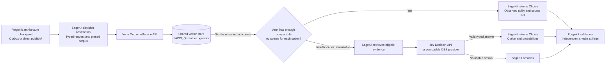
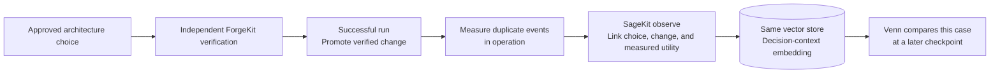

# SageKit

SageKit wraps Venn's vector decision engine with a read-write engineering
knowledge corpus. `sagekit add` writes a record and its embedding. Venn reads
observed outcomes from that same vector store. Jev or a compatible OSS model
provides typed inference when there is insufficient precedent. Git and SQLite
retain the local records, access rules and history. The vector store handles
similarity search. ForgeKit can consult SageKit at verification gates and
publish verified changes after the pipeline succeeds.

- [Architecture validation checkpoint](#architecture-validation-checkpoint)
- [How verified outcomes reach Venn](#how-verified-outcomes-reach-venn)
- [Quick start](#quick-start)
- [Guides](#guides)

## Architecture validation checkpoint

**Which publishing design should checkout use to limit duplicate order events
when the broker accepts an event but its acknowledgement is lost?** At the
architecture checkpoint, ForgeKit asks SageKit for a **Choice** between a
transactional outbox and direct publish. It asks Venn to compare observed
duplicate events per 10,000 orders, where lower is better.



The Venn API shown here is the in-process `OutcomeService`. Its adapter
searches the vector store that SageKit writes to. The fallback sends Jev the
same Choice question plus eligible corpus evidence. A required gate can
block on abstention or insufficient evidence. A recommendation still goes
through ForgeKit's independent architecture and acceptance checks.

| Decision API type | Example question | Illustrative Jev response |
| --- | --- | --- |
| [Choice](examples/architecture-choice.json) | Which publishing design should checkout use? | `transactional-outbox` with option probabilities of `0.78` and `0.22` |
| [Score](examples/architecture-score.json) | How complete is the rollback plan? | `1.0` on a three-level rubric, meaning actionable steps with missing verification |
| [Noul](examples/architecture-noul.json) | Does every retry preserve the event ID? | `0.91` probability that the statement is true |

Venn's observed-outcome route handles a Choice with a matching decision family
and metric. It returns measured utility and supporting observations. Score and
Noul go directly to the configured Decision API provider. See the
[request and response examples](docs/decision-engine.md#architecture-decision-examples)
for both branches.

## How verified outcomes reach Venn



A successful build records the verified change. A measured operational outcome
supplies the utility Venn needs to compare alternatives.

## Quick start

Requires Python 3.11 or newer.

```sh
python -m pip install .
sagekit --root corpus add examples/adr.json
sagekit --root corpus query "idempotent checkout"
sagekit --root corpus snapshot
sagekit --root corpus list
python -m unittest discover -s tests -v
```

Track `corpus/knowledge.jsonl` in Git. SQLite rebuilds from the journal.
Restricted records require a private corpus checkout and appropriate filesystem
permissions. Use `--group GROUP` before a local command to access a restricted
record. The remote service assigns groups and scopes from the configured token.

## Guides

- [Venn, Jev, and the vector write path](docs/decision-engine.md)
- [Corpus, search, providers, and hosting](docs/operation.md)
- [ForgeKit contextual gates and promotion](docs/forgekit.md)
- [Ordered specifications and verification coverage](specs/README.md)
